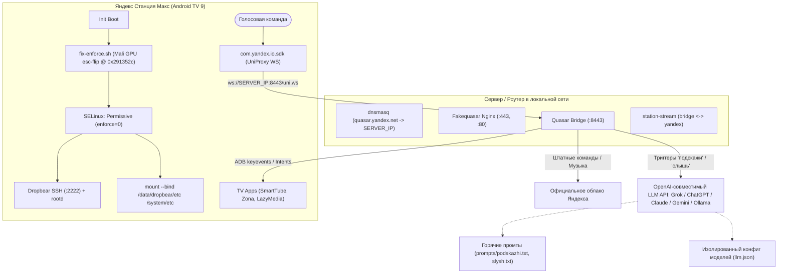

# Yandex Station Max (YNDX-0008 / YNDX-00052 / YNDX-00053)
## Complete Guide: Downgrade, GPU Root Exploit, Persistence, TV Apps & Quasar Voice Bridge

<p align="left">
  <a href="https://t.me/YaMaxR00t" target="_blank">
    
  </a>
</p>

> [!TIP]
> 💬 **Telegram-сообщество проекта:** Помощь в установке, обсуждение рута, свежие прошивки и модули для Станции Макс — присоединяйтесь: **[t.me/YaMaxR00t](https://t.me/YaMaxR00t)** (@YaMaxR00t)

Готовый автономный комплекс для превращения **Яндекс Станции Макс** в открытую мультимедийную систему на Android TV с постоянным Root-доступом, SSH (порт 2222), голосовым управлением **SmartTube** (YouTube без рекламы), каталогами **Zona**, **LazyMedia Deluxe**, AirPlay, Spotify Connect и возможностью мгновенного переключения между локальным мостом и официальным облаком Яндекса одной командой.

---

## 1. Возможности комплекса

* 🔓 **Полноценный Root и персистентность:** Снятие ограничений через уязвимость видеоядра Mali GPU (`esc-flip`), постоянный Root-демон `rootd` и Dropbear SSH (порт 2222), автоматически стартующие при перезагрузке колонки.
* 🛡️ **100% безопасность dm-verity:** Никаких опасных правок в `/system`, `/vendor` или `/boot`. Все модификации изолированы в свободном разделе `/odm` и `/data`.
* 📺 **SmartTube Voice Bridge:** Мгновенный отклик на голосовые команды плеера (< 70 мс) на чистом Go:
  * **Zero TTS:** Быстрые команды («пауза», «продолжи», «дальше», «назад», «домой») выполняются абсолютно беззвучно без навязчивых реплик Алисы.
  * **Плавный старт видео:** При команде *«Включи на ютубе ...»* Алиса сначала проговаривает фразу, и только затем запускается воспроизведение.
* 🎬 **Каталоги фильмов и сериалов:** Голосовой запуск **Zona TV** (*«открой зону»*) и **LazyMedia Deluxe** (*«открой медиа»*).
* 🔄 **Однокнопочный переключатель потоков (`station-stream`):** Мгновенный переход между Quasar Bridge и официальным облаком Яндекса без перезагрузки колонки.
* ⚡ **Автономный мост прямо на Станции (Standalone On-Device):** Возможность запуска Quasar Bridge непосредственно на ARM64-процессоре Станции Макс без внешнего сервера (`./scripts/deploy_standalone.sh`). Подробное руководство см. в [QUASAR_GUIDE.md](file:///Volumes/prots/dev/station_max/QUASAR_GUIDE.md).
* 📊 **Кастомный Neofetch Станции Макс:** Системная утилита в `/odm/bin/neofetch` со стилизованной ASCII-графикой Станции Макс, часами реального времени и выводом характеристик (SoC Amlogic S905X2, GPU Mali-G31 MP2, YaOS_X / Android 9).
* 🧠 **Модульная нейросетевая подсистема (Multi-LLM & Горячие промты):** Полная независимость от конкретного провайдера нейросетей. Подключение любых моделей через OpenAI-совместимый API (Grok, ChatGPT, Claude, Gemini, DeepSeek, локальные Ollama / vLLM):
  * **Режим умного ассистента (*«Алиса, подскажи ...»*):** Структурированные ответы с поддержкой follow-up диалога (кольцо станции продолжает слушать уточнения).
  * **Режим альтернативной персоны (*«Алиса, слышь ...»*):** Дерзкий, саркастичный собеседник (по умолчанию настроен на Grok-4.5 roast persona).
  * **Горячая смена системных промтов:** Промты вынесены в отдельные текстовые файлы (`configs/quasar-bridge/prompts/`), которые перечитываются на каждый запрос без перезапуска моста.
  * **Детекция шепота и адаптивный TTS:** Мост определяет, когда пользователь говорит шепотом, и автоматически переключает синтез речи в режим шепота (`whisper`) либо нужную эмоцию (`evil`, `neutral`).
* 🎵 **AirPlay 2 и Spotify Connect:** Полноценный нативный ресивер **Apple AirPlay 2** (`shairport-sync` 5.6.2 + `nqptp` 1.2.9 PTP multiroom sync, Android NSD mDNS, двухсторонний мост громкости) и фоновый демон `librespot`.
* 🎧 **Голосовое управление Spotify TV:** Host-side контроллер ([`spotify/`](spotify/README.md)) приглушает Spotify на время прослушивания и ответа ассистента, возобновляет музыку только если паузу поставил он сам и пользователь не сказал «выключи», и исполняет команды «пауза / продолжи / следующий / предыдущий / включи в Spotify …» без путаницы с Яндекс Музыкой.
* 🤖 **Telegram Control Bot (`station-bot`):** Полноценное дистанционное управление Станцией Макс и Quasar Bridge через Telegram: статус устройства, регулировка громкости и эквалайзера, переключение потоков (Bridge/Яндекс), управление LED-экраном, контроль ТВ-плееров (SmartTube/Zona/LazyMedia), просмотр и переключение моделей LLM на лету.

---

## 2. Поддерживаемые устройства

| Модель | Кодовое имя | SoC | Архитектура | ОС |
|---|---|---|---|---|
| **Яндекс Станция Макс** | `YNDX-0008` | Amlogic S905X2 | arm64-v8a | Android TV 9 (Pie) |
| **Яндекс Станция Макс с Zigbee** | `YNDX-00052` | Amlogic S905X2 | arm64-v8a | Android TV 9 (Pie) |
| **Яндекс Станция Макс с Zigbee** | `YNDX-00053` | Amlogic S905X2 | arm64-v8a | Android TV 9 (Pie) |

> [!NOTE]
> Модели **YNDX-00052** и **YNDX-00053** (версии со встроенным Zigbee) имеют полностью идентичную аппаратную платформу (Amlogic S905X2, Mali-G31 MP2, 2 ГБ LPDDR4) и поддерживают одинаковый стек эксплойта, персистентности и прошивок.

### Поддерживаемые сборки прошивки и оффсеты ядра

| Сборка (`ro.build.display.id`) | Модель | Смещение `selinux_enforcing` (PA) | Описание |
|---|---|---|---|
| `PPR1.180610.011.5000000921` (`5000000921`) | `YNDX-00052`, `YNDX-00053`, `YNDX-0008` | `0x291352c` | Основная проверенная прошивка (рекомендуемый даунгрейд с открытым сетевым ADB) |
| `PPR1.180610.011.20201111` (`20201111`) | `YNDX-0008` (Base Max) | `0x2a5052c` | Релизная заводская прошивка первой ревизии Станции Макс (ноябрь 2020 г.) |

> [!TIP]
> Скрипты `scripts/03_exploit_root.sh` и `/odm/bin/fix-enforce.sh` автоматически считывают `ro.build.display.id` и выбирают корректное смещение (`0x291352c` или `0x2a5052c`).

---

## 3. Архитектура системы



---

## 4. Структура репозитория

```
station_max/
├── README.md                           # Эта подробная инструкция
├── AGENT.md                            # Операционный регламент для ИИ-агентов
├── airplay2/                           # Исходники и сборка нативного AirPlay 2
│   ├── src/                            # Shairport-Sync 5.6.2 & NQPTP 1.2.9 PTP
│   ├── android/                        # Android NSD Service & Java Volume Bridge
│   ├── device/                         # Скрипты жизненного цикла (start, stop, boot)
│   ├── tools/                          # airplayctl.py, build.py, package.py
│   ├── release/                        # Автономный релизный бандл (payload.tar, release.json)
│   └── install.py                      # Автономный установщик на устройство
├── apps/                               # Проверенные APK для Android TV
│   ├── SmartTube_beta_32.70_arm64-v8a.apk
│   ├── zona_3.0.77.apk
│   └── lazycatsoftware.lmd-3.470.apk
├── binaries/                           # Нативные бинарники arm64
│   ├── airplay2/                       # Бинарники AirPlay 2 (ya-shairport, ya-nqptp, ...)
│   ├── permissive                      # Эксплойт Mali GPU (esc-flip)
│   ├── rootd                           # Демон выполнения root-команд (v4)
│   ├── dropbearmulti                   # Dropbear SSH + SCP + keygen
│   ├── audiosink                       # ALSA вывод звука
│   └── librespot                       # Spotify Connect receiver
├── certs/                              # Каталог для TLS-сертификатов (добавляются пользователем)
│   └── README.md                       # Инструкция по получению/созданию сертификатов
├── configs/
│   ├── dnsmasq/station_max.conf        # DNS перенаправление quasar.yandex.net
│   ├── nginx/quasar.conf               # Конфиг Nginx для fakequasar
│   ├── nginx/real_sync_info.json       # Ответ синхронизации с авто-включением ADB
│   ├── odm/                            # Скрипты автозапуска и сервисы для /odm
│   │   ├── fix-enforce.sh
│   │   ├── start-dropbear.sh
│   │   ├── start-airplay2.sh
│   │   ├── su
│   │   ├── enforce-watchdog.sh
│   │   ├── rootd.rc
│   │   ├── zz-adbd.rc
│   │   └── zz-permissive.rc
│   ├── quasar-bridge/                  # Конфигурация моста, LLM и промтов
│   │   ├── config.json                 # Маршрутизация команд моста
│   │   ├── llm.json                    # Независимый конфиг моделей и API-ключей
│   │   ├── llm_backup.json             # Резервный профиль LLM
│   │   ├── prompts/                    # Системные промты (горячая перезагрузка)
│   │   │   ├── podskazhi.txt           # Промт ассистента для «подскажи»
│   │   │   └── slysh.txt               # Промт роаст-персоны для «слышь»
│   │   ├── quasar-bridge.service
│   │   └── smarttube_mcp.py
│   └── station-bot/                    # Конфигурация Telegram Control Bot
│       ├── bot.env.example             # Пример файла окружения (.env)
│       └── station-bot.service         # Systemd unit для автозапуска бота
├── quasar-bridge-patches/              # Исходники расширений Quasar Bridge (Go)
│   ├── cmd/quasar-bridge/
│   └── internal/bridge/
├── station-bot/                        # Telegram Control Bot на чистом Go
│   ├── main.go                         # Точка входа, флаги (-env, -check)
│   ├── config.go                       # Парсер .env и валидация
│   ├── tg_client.go                    # Telegram Bot API HTTP-клиент
│   ├── tg_ui.go                        # Интерактивное инлайн-меню и обработчики
│   ├── station_ops.go                  # Операции с колонкой (SSH, ADB, MediaDaemon)
│   ├── bridge_config.go                # Управление конфигом моста и LLM
│   └── protobuf_userconfig.go          # Чтение/запись protobuf user_config.dat
└── scripts/
    ├── full_deploy.sh                  # Единый интерактивный мастер-установщик
    ├── 01_setup_server.sh              # Шаг 1: Настройка Fakequasar Nginx + Dnsmasq
    ├── 02_trigger_downgrade.sh         # Шаг 2: Безопасный даунгрейд до 5000000921
    ├── 03_exploit_root.sh              # Шаг 3: Эксплойт Mali, Root & SSH
    ├── 04_install_apps.sh              # Шаг 4: Установка SmartTube, Zona, LazyMedia
    ├── 05_deploy_bridge.sh             # Шаг 5: Сборка моста и переключение потока
    ├── update.sh                       # Дифференциальный апдейтер (--bridge, --station, --airplay)
    └── station-stream.py               # Однокнопочный переключатель потоков
```

---

## 5. Быстрый старт: автоматическая установка

> [!IMPORTANT]
> ### ⚠️ Обязательные компоненты (добавляются пользователем)
> В репозитории **полностью отсутствуют** любые проприетарные бинарники и приватные ключи:
> 1. **Официальный образ прошивки `5000000921.zip`:** скачайте самостоятельно из профильных тем сообщества (4PDA, Telegram) и поместите в `/opt/fakequasar/ota/5000000921.zip`.
> 2. **TLS-сертификаты Fakequasar:** поместите приватный ключ `quasar-all.key` и цепочку `fullchain_with_root.pem` в каталог `certs/` (подробнее см. [certs/README.md](certs/README.md)).

Запустите мастер-скрипт и следуйте подсказкам:

```bash
cd scripts
./full_deploy.sh [STATION_IP] [SERVER_IP]
```

Скрипт пошагово предложит выполнить этапы:
1. Настройку Fakequasar Nginx и DNSMasq на сервере.
2. Даунгрейд прошивки (если колонка ещё не на `5000000921`).
3. Эксплойт видеоядра Mali, установку персистентного Root и SSH на порт 2222.
4. Установку приложений (SmartTube, Zona, LazyMedia) и исправление прав каталогов.
5. Сборку и запуск Quasar Bridge и переключение голосового потока.

---

## 6. Пошаговое руководство

### Шаг 1: Настройка сервера Fakequasar и DNSMasq

> [!IMPORTANT]
> **Сертификаты для Fakequasar добавляются пользователем:**
> Приватные ключи и TLS-сертификаты для эмуляции `quasar.yandex.net` не входят в репозиторий в целях соблюдения авторских прав и политик безопасности. Перед запуском шага 1 поместите в каталог `certs/` файлы:
> - `certs/fullchain_with_root.pem` (цепочка сертификатов)
> - `certs/quasar-all.key` (приватный ключ)
> (Их можно извлечь из дампов сообщества на 4PDA/Telegram либо сгенерировать собственный CA). Подробнее см. [certs/README.md](certs/README.md).

На сервере или роутере в локальной сети:
```bash
./scripts/01_setup_server.sh <SERVER_IP>
```
*(Если аргумент не передан, скрипт автоматически определит IP текущего хоста или запросит ввод)*

Скрипт:
* Создает `/opt/fakequasar/certs` и копирует ваши сертификаты из `certs/`.
* Настраивает `real_sync_info.json` с авто-активацией ADB (`remoteActivation: true`).
* Разворачивает Nginx-конфиг для эмуляции серверов Яндекса (`quasar.yandex.net`).
* Настраивает `dnsmasq` для перенаправления доменов на ваш сервер.

### Шаг 2: Безопасный даунгрейд до 5000000921

> [!IMPORTANT]
> **Официальная прошивка 5000000921.zip:**
> Бинарные образы оригинальных прошивок Яндекса защищены авторским правом и не распространяются через GitHub. Файл прошивки `5000000921.zip` необходимо найти самостоятельно (в профильных темах 4PDA или Telegram-каналах энтузиастов) и положить в `/opt/fakequasar/ota/5000000921.zip` на сервере.

Колонка должна находиться на уязвимой сборке `5000000921`.
Поместите файл `5000000921.zip` в `/opt/fakequasar/ota/` и выполните:
```bash
./scripts/02_trigger_downgrade.sh <SERVER_IP> <STATION_IP>
```
Колонка скачает прошивку, перезагрузится в Recovery, установит сборку `5000000921` и вернется в рабочий режим.

### Шаг 3: Получение Root и установка Dropbear SSH

Выполните эксплойт видеоядра:
```bash
./scripts/03_exploit_root.sh <STATION_IP>
```
Что делает скрипт:
1. Загружает `permissive` в `/data/local/tmp/`.
2. Определяет версию прошивки (`5000000921` или `20201111`) и вызывает `permissive esc-flip <OFFSET> 1 0` (`0x291352c` либо `0x2a5052c`), инвертируя байт `selinux_enforcing` в памяти ядра Linux.
3. Монтирует свободный раздел `/odm` в режим чтения-записи (`rw`).
4. Копирует `rootd`, `dropbearmulti` и скрипты в `/odm/bin/` и `/odm/etc/init/`.
5. Настраивает файл автозапуска `/data/local/tmp/cmdin`.
6. Генерирует ключи хоста Dropbear и импортирует ваш `~/.ssh/id_*.pub` (при отсутствии ключа генерирует новый ed25519).
7. Стартует SSH на порту `2222`.

Проверка:
```bash
ssh -p 2222 root@<STATION_IP> "id; getenforce"
# Должно вернуть: uid=0(root) gid=0(root) / Permissive
```

### Шаг 4: Установка ТВ-приложений

Установите приложения и примените критические исправления прав:
```bash
./scripts/04_install_apps.sh <STATION_IP>
```
> [!IMPORTANT]
> **Критическое исправление прав каталогов:**
> При монтировании `/data/dropbear/etc` поверх `/system/etc` нельзя сбрасывать права через `chmod 644 /data/dropbear/etc/*`. Скрипт гарантирует `755` на всех директориях (`find -type d -exec chmod 755 {} +`), предотвращая зависание приложений на сером экране и сбои доверенных сертификатов.

### Шаг 5: Сборка и деплой Quasar Bridge (Локально или Удаленно)

Quasar Bridge поддерживает два варианта реализации (подробное сравнение и инструкцию см. в [QUASAR_GUIDE.md](file:///Volumes/prots/dev/station_max/QUASAR_GUIDE.md)):

#### Вариант А: Автономно на самой Станции (Standalone On-Device — Рекомендуется)
Не требует внешних серверов или ПК. Мост запускается прямо на процессоре Станции:
```bash
./scripts/deploy_standalone.sh <STATION_IP>
```
*Для отката обратно на внешний сервер:* `./scripts/rollback_standalone.sh <STATION_IP> <SERVER_IP>`

#### Вариант Б: На внешнем сервере (External Server Mode)
Разверните мост на целевом Linux-сервере (локально или через SSH):
```bash
# Локально на сервере:
./scripts/05_deploy_bridge.sh localhost <STATION_IP> <SERVER_IP>

# Удаленно по SSH на сервер/роутер:
./scripts/05_deploy_bridge.sh <SERVER_USER@SERVER_IP> <STATION_IP> <SERVER_IP>
```
Скрипт перенесет исходники Go, скомпилирует бинарник `quasar-bridge` (или установит готовый из `binaries/quasar-bridge`), настроит службы `systemd` (`quasar-bridge.service` и `adb-station.service`) и вызовет `station-stream bridge` для переключения Станции на удаленный мост.

---

## 7. Голосовое управление

### Воспроизведение YouTube (SmartTube)
| Команда | Действие | Реакция Алисы |
|---|---|---|
| *«Включи на ютубе Кино»* | Поиск и автовоспроизведение в SmartTube | *«Включаю «Кино» на YouTube.»* |
| *«Открой ютуб»* / *«Запусти smarttube»* | Открытие главного экрана SmartTube | *«Открываю YouTube.»* |
| *«Пауза»* / *«На паузу»* | `input keyevent 127` | *Без звука (Zero TTS)* |
| *«Продолжи»* / *«Сними с паузы»* | `input keyevent 126` | *Без звука (Zero TTS)* |
| *«Дальше»* / *«Следующее видео»* | `input keyevent 87` | *Без звука (Zero TTS)* |
| *«Назад»* / *«Предыдущее»* | `input keyevent 88` | *Без звука (Zero TTS)* |
| *«Сначала»* / *«Начни сначала»* | Двойной `keyevent 88` | *Без звука (Zero TTS)* |
| *«Перемотай на 2 минуты вперед»* | Серия `input keyevent 90` | *Без звука (Zero TTS)* |
| *«Перемотай назад»* | Серия `input keyevent 89` | *Без звука (Zero TTS)* |
| *«Стоп»* / *«Хватит»* / *«Закрой ютуб»* | `keyevent 127; am force-stop org.smarttube.beta; keyevent 3` | *Без звука (Zero TTS)* |
| *«Что сейчас играет?»* | Чтение метаданных `dumpsys media_session` | *«Сейчас играет: «...».»* |

### ТВ-каталоги и системная навигация
| Команда | Действие | Реакция Алисы |
|---|---|---|
| *«Открой зону»* / *«Включи зону»* | Пауза плеера + запуск `mobi.zona` | *«Открываю Зону.»* |
| *«Открой медиа»* / *«Запусти медиа»* | Пауза плеера + запуск `lazycatsoftware.lmd` | *«Открываю медиа.»* |
| *«Домой»* / *«Главный экран»* | `keyevent 127; keyevent 3` | *Без звука (Zero TTS)* |

### Мульти-LLM и персоны (Нейросетевой модуль)
| Команда | Действие | Реакция Алисы | Описание |
|---|---|---|---|
| *«Алиса, подскажи [вопрос]»* | Запрос к ассистентской LLM (`assistant_*`) | Обычный голос | Структурированный развернутый ответ по промту `prompts/podskazhi.txt`. Кольцо станции продолжает светиться для уточняющих вопросов (follow-up диалог). |
| *«Алиса, слышь [фраза]»* | Запрос к роаст-персоне (`llm_*`) | Саркастичный / дерзкий | Острый, саркастичный ответ по промту `prompts/slysh.txt` (по умолчанию настроен Grok-4.5). |
| *Шёпот («...»)* | Авто-детекция тихого голоса | Шёпот (`whisper`) | Мост распознает шёпот пользователя и автоматически переключает синтез речи в режим шепота без изменения громкости. |

---

## 8. Настройка независимой LLM-подсистемы и промтов

Интеграция с нейросетями в Quasar Bridge полностью модульная и независима от кода:
1. **Любой OpenAI-совместимый эндпоинт:** xAI (Grok), OpenAI (GPT-4o), Anthropic Claude (через proxy), Google Gemini (через compatibility endpoint), DeepSeek или локальные серверы (Ollama, vLLM, LM Studio).
2. **Раздельные профили моделей:** Для разных голосовых триггеров можно настраивать независимые модели, лимиты токенов и эндпоинты в `configs/quasar-bridge/llm.json`.
3. **Горячая смена системных промтов:** Тексты промтов читаются с диска при каждом голосовом запросе. Любые правки файлов вступают в силу мгновенно без рестарта службы моста.

### 8.1 Конфигурация `llm.json`
Файл `/opt/quasar-bridge/llm.json` на сервере:
```json
{
  "assistant_base_url": "https://api.openai.com/v1",
  "assistant_model": "gpt-4o",
  "assistant_api": "chat_completions",
  "assistant_api_key": "YOUR_API_KEY",
  "assistant_chat_parameters": {
    "reasoning_effort": "low"
  },
  "assistant_max_output_tokens": 4096,

  "llm_base_url": "https://api.x.ai/v1",
  "llm_model": "grok-4.5",
  "llm_api": "chat_completions",
  "llm_api_key": "YOUR_API_KEY",
  "llm_chat_parameters": {
    "reasoning_effort": "low"
  },
  "llm_max_output_tokens": 400
}
```

* `assistant_*` — параметры для триггера *«Алиса, подскажи ...»* (умный помощник, развернутые ответы, follow-up режим диалога).
* `llm_*` — параметры для триггера *«Алиса, слышь ...»* (роаст-персона, короткие хлесткие реплики).

### 8.2 Редактирование системных промтов (Hot-Reload)
В каталоге `/opt/quasar-bridge/prompts/`:
* `podskazhi.txt` — системный промт помощника: точность, четкость, естественная устная речь без списков со звездочками.
* `slysh.txt` — характер роаст-персоны: сарказм, ирония, дерзость.

> [!TIP]
> **Промты обновляются на лету:**
> Отредактируйте файл `prompts/slysh.txt` или `prompts/podskazhi.txt` прямо на сервере — следующая же голосовая реплика будет сгенерирована по обновленному промту без перезапуска демона.

### 8.3 Тестирование из терминала (`test-llm-stream.py`)
В репозитории есть готовая утилита для проверки подключения к LLM и калибровки промтов:
```bash
# Проверить режим ассистента:
python3 scripts/test-llm-stream.py --prompt podskazhi "Как работает фотосинтез?"

# Проверить роаст-персону Grok:
python3 scripts/test-llm-stream.py --prompt slysh "Ты кто такая вообще?"

# Переопределить модель на лету:
python3 scripts/test-llm-stream.py --model gpt-4o-mini "Привет"
```

---

## 9. Telegram Control Bot: Дистанционное управление Станцией

В состав комплекса входит полноценный Telegram-бот на чистом Go для удаленного мониторинга, управления воспроизведением, регулировки подсветки, звука и переключения параметров моста и LLM.

### 9.1 Основные возможности
* 📊 **Мониторинг Станции:** Проверка доступности портов (SSH :2222, ADB :5555, MediaDaemon :4545, Bridge :8443), текущий PID процесса `com.yandex.io.sdk`, режим монтирования `/odm`.
* 📺 **Медиа и ТВ:** Управление запущенным плеером (SmartTube, Zona, LazyMedia): Пауза / Возобновить, перемотка вперед/назад, следующий/предыдущий трек, получение названия и текущего таймкода видео.
* 🔊 **Аудио и Эквалайзер:** Регулировка громкости музыки (0–100%) и будильника, переключение пресетов эквалайзера станции.
* 💡 **LED-экран:** Изменение яркости дисплея (`/dev/fb4` и `led_brightness`) в реальном времени, стили отображения времени, выключение экрана.
* 🔄 **Потоки и Quasar Bridge:** Переключение потока одной кнопкой (Bridge <-> Яндекс Облако), выбор активной модели LLM из списка, включение/выключение правил маршрутизации.
* 🔒 **Безопасность (Whitelist):** Строгий доступ только для указанных пользователей (`TELEGRAM_ALLOWED_USERS`). При первом запуске неавторизованный пользователь получает свой numeric ID, который достаточно скопировать в конфиг.

### 9.2 Развертывание бота
Скрипт `update.sh` автоматически собирает и настраивает бота на сервере:
```bash
./scripts/update.sh --bot
```
Либо вручную:
```bash
# 1. Собрать бинарник:
cd station-bot
go build -o /opt/quasar-bridge/bin/station-bot .

# 2. Создать директорию и скопировать конфиг:
sudo mkdir -p /opt/station-bot
sudo cp configs/station-bot/bot.env.example /opt/station-bot/bot.env
sudo chmod 600 /opt/station-bot/bot.env

# 3. Установить systemd unit:
sudo cp configs/station-bot/station-bot.service /etc/systemd/system/
sudo systemctl daemon-reload
sudo systemctl enable station-bot
```

### 9.3 Настройка `/opt/station-bot/bot.env`
```bash
# Токен от @BotFather:
TELEGRAM_BOT_TOKEN=123456789:ABCdefGHIjklMNOpqrSTUvwxyz

# Разрешенные ID пользователей через запятую:
TELEGRAM_ALLOWED_USERS=123456789

# IP адрес Станции:
STATION_IP=192.168.1.50
STATION_SSH_PORT=2222
STATION_SSH_USER=root
STATION_ADB_PORT=5555
STATION_MEDIA_PORT=4545

# Параметры Quasar Bridge:
BRIDGE_CONFIG_PATH=/opt/quasar-bridge/config.json
BRIDGE_BIN_PATH=/opt/quasar-bridge/bin/quasar-bridge
BRIDGE_HEALTH_URL=http://127.0.0.1:8443/healthz
BRIDGE_SERVER_IP=192.168.1.1
STREAM_SCRIPT_PATH=/usr/local/bin/station-stream
```

### 9.4 Запуск и диагностика
```bash
# Тестовая проверка всех подключений без запуска бота:
/opt/quasar-bridge/bin/station-bot -env /opt/station-bot/bot.env -check

# Перезапуск службы:
sudo systemctl restart station-bot

# Просмотр логов:
sudo journalctl -u station-bot -f
```

---

## 10. Дифференциальная система обновлений (`update.sh`)

Если вы внесли изменения в код Go, скрипты на Станции или обновили APK, **не требуется повторно запускать полный деплой или перепрошивать колонку**.

Используйте быстрый дифференциальный апдейтер:

```bash
# Обновить всё сразу (Bridge + Station scripts + Configs + Bot):
./update.sh <SSH_HOST> <STATION_IP>

# Обновить только Quasar Bridge (перенос патчей Go, пересборка, рестарт службы):
./update.sh --bridge

# Собрать и обновить Telegram Control Bot (station-bot):
./update.sh --bot

# Обновить только скрипты на Станции (odm / fix-enforce / dropbear / права 755):
./update.sh --station

# Обновить/переустановить только ТВ-приложения (SmartTube, Zona, LazyMedia):
./update.sh --apps

# Обновить и развернуть нативный стек Apple AirPlay 2:
./update.sh --airplay
```

> [!TIP]
> При первом запуске скрипт сохраняет целевой сервер и IP Станции в локальный `.station_env`. При последующих вызовах можно просто вводить `./update.sh` или `./update.sh -b` без повторного ввода адресов!

---

## 11. Apple AirPlay 2: Нативная интеграция

Комплекс включает полностью независимый, нативный стек **Apple AirPlay 2** с поддержкой:
* **PTP синхронизации (IEEE 1588 / NQPTP):** Точная синхронизация тактовых частот до микросекунд для мультирумного воспроизведения совместно с другими устройствами Apple (HomePod, Apple TV, Mac).
* **Многопоточности и буферизованного аудио (Buffered Audio):** Бесшовное воспроизведение тяжелых аудиопотоков без заиканий и рассинхрона видео.
* **Нативного Android NSD (Network Service Discovery):** Фоновый Java-сервис объявляет колонку в mDNS локальной сети (`Яндекс станция Макс` как `_airplay._tcp` и `_raop._tcp`).
* **Двухстороннего моста громкости (Volume Bridge):** Изменение громкости на iPhone/iPad/Mac немедленно меняет системную громкость Android TV Станции и наоборот.
* **Приоритета голоса:** При обращении к Алисе воспроизведение AirPlay плавно приглушается.

### Управление AirPlay 2:
```bash
# Статус сервисов (supervisor, nqptp, shairport):
python3 airplay2/tools/airplayctl.py status --root su --yes

# Развертывание / обновление стека:
./scripts/update.sh --airplay

# Локальная проверка видимости в mDNS с Mac:
dns-sd -B _airplay._tcp local
```

Подробная документация по архитектуре, сборке и устранению неполадок доступна в [AIRPLAY2.md](AIRPLAY2.md).

---

## 12. Однокнопочный переключатель потоков (`station-stream`)

Утилита установлена в `/usr/local/bin/station-stream` на сервере:

### 1. Проверить текущий статус:
```bash
station-stream status <STATION_IP>
```
Выведет активные параметры `uniProxyUrl`, `uniProxyQuicUrl` и текущее подключение к порту 8443.

### 2. Переключить на Quasar Bridge:
```bash
station-stream bridge <STATION_IP> <SERVER_IP>
```
* Переписывает `uniProxyUrl = "ws://<SERVER_IP>:8443/uni.ws"`.
* Очищает `uniProxyQuicUrl` (блокирует UDP-обход).
* Корректирует `user_config.dat` с сохранением байтового выравнивания.
* Мягко перезапускает процесс `com.yandex.io.sdk`.

### 3. Вернуть на официальный Яндекс:
```bash
station-stream yandex <STATION_IP>
```
Мгновенно восстанавливает `wss://uniproxy.alice.yandex.net/uni.ws` и оригинальные настройки.

---

## 13. Диагностика и решение проблем

### Проблема: Приложения (SmartTube, Zona) висят на сером экране
* **Причина:** Нарушены права на чтение контекстов безопасности в `/data/dropbear/etc`.
* **Решение:**
  ```bash
  ssh -p 2222 root@<STATION_IP> 'find /data/dropbear/etc -type d -exec chmod 755 {} + && find /data/dropbear/etc -type f -exec chmod 644 {} +'
  ```

### Проблема: SSH порт 2222 недоступен после перезагрузки
* **Причина:** Задержка переключения SELinux через Mali GPU (до 15 секунд).
* **Решение:** Подождите 15–20 секунд после завершения загрузки системы. Если порт не открылся:
  ```bash
  adb -s <STATION_IP>:5555 shell "/odm/bin/start-dropbear.sh &"
  ```

### Проблема: ADB не подключается по порту 5555
* **Решение через SSH:**
  ```bash
  ssh -p 2222 root@<STATION_IP> "setprop service.adb.tcp.port 5555 && settings put global adb_enabled 1 && stop adbd && start adbd"
  ```
* **Решение без SSH:** Убедитесь, что `real_sync_info.json` содержит `"adbd": {"remoteActivation": true, "network": true}` и перезагрузите питание колонки.

### Проблема: Колонка не отображается в списке AirPlay на iPhone/Mac
* **Причина:** Служба NSD (Network Service Discovery) не успела зарегистрироваться или демон остановлен.
* **Решение:**
  ```bash
  # Проверить статус демона:
  python3 airplay2/tools/airplayctl.py status --root su --yes
  # Перезапустить стек:
  ./scripts/update.sh --airplay
  ```

---

## 14. Лицензирование, источники компонентов и отказ от ответственности

### 14.1 Отказ от ответственности (Disclaimer)
* Данный проект является независимым открытым исследовательским программным комплексом (Open Source) и создан исключительно в образовательных, исследовательских и ознакомительных целях.
* Проект **не аффилирован**, **не связан**, **не спонсируется** и **не одобрен** корпорациями:
  * **ООО «Яндекс»** (Yandex N.V.) — торговые марки «Яндекс», «Яндекс Станция», «Алиса» являются собственностью ООО «Яндекс».
  * **Apple Inc.** — Apple, AirPlay, iPhone, iPad, Mac являются зарегистрированными товарными знаками Apple Inc.
  * **Google LLC** — Android, Android TV, YouTube являются товарными знаками Google LLC.
  * **Spotify AB** — Spotify является зарегистрированным товарным знаком Spotify AB.
* Все упомянутые товарные знаки, фирменные наименования и логотипы принадлежат их законным правообладателям.
* Авторы проекта не несут ответственности за возможные программные сбои, потерю гарантии или изменение функциональности устройств в результате действий пользователя. Все модификации выполняются пользователем на свой страх и риск.

### 14.2 Основная лицензия
Исходный код авторских адаптеров, скриптов автоматизации, демонов и сетевого моста распространяется под свободной лицензией **MIT** (см. файл [LICENSE](LICENSE)).

### 14.3 Источники и авторы сторонних компонентов (Credits & Upstream)

| Компонент / Модуль | Описание и назначение | Источник / Upstream | Лицензия |
|---|---|---|---|
| **Quasar Bridge** | WebSocket-проксирование протокола голосового движка io_device | Исследования протокола UniProxy и открытые наработки сообщества | MIT |
| **Mali GPU Exploit (`permissive`)** | Переключение SELinux в Permissive через видеоядро ARM Mali (Mali-G31 / Bifrost) | Исследование уязвимости ядра Linux и драйвера `/dev/mali0` | Open Source |
| **Dropbear SSH** | Легковесный SSH-сервер и клиент для встраиваемых систем | [Dropbear SSH](https://matt.ucc.asn.au/dropbear/dropbear.html) (Matt Johnston) | MIT-style |
| **Shairport Sync (AirPlay 2)** | Нативный приемник аудиопотоков Apple AirPlay 2 | [Shairport Sync](https://github.com/mikebrady/shairport-sync) (Mike Brady) | MIT / BSD |
| **NQPTP** | Синхронизация тактовой частоты по стандарту IEEE 1588 PTP | [NQPTP](https://github.com/mikebrady/nqptp) (Mike Brady) | GPL-2.0 |
| **SmartTube** | Клиент YouTube без рекламы для Android TV | [SmartTube](https://github.com/yuliskov/SmartTube) (Yuriy Liskov) | GPL-3.0 |
| **Librespot** | Open Source клиент библиотеки Spotify Connect | [librespot-org/librespot](https://github.com/librespot-org/librespot) | MIT |
| **MediaDaemon / MediaSeeker** | Нативный Android bridge к ISessionController и ExoPlayer | Авторская разработка на Android Bionic / DEX | MIT |
| **Station Bot** | Дистанционное Telegram-управление Станцией на Go | Авторская разработка в рамках проекта | MIT |
| **Zona TV** | Каталог фильмов и сериалов для Android TV | [mobi.zona](https://w1.zona.pub/) (Стороннее ПО) | Freeware |
| **LazyMedia Deluxe** | Каталог и агрегатор медиаконтента для Android TV | [LazyCat Software](https://lazymedia.su/) (Стороннее ПО) | Freeware |

### 14.4 Проприетарные компоненты, сертификаты и прошивки
* В репозитории **полностью отсутствуют**:
  * Официальные бинарные образы прошивок Яндекс Станции (включая архив даунгрейда `5000000921.zip`).
  * Приватные ключи и официальные TLS-сертификаты сервисов Яндекса (`quasar-all.key`, `fullchain_with_root.pem`).
* Все подобные компоненты пользователь находит и добавляет самостоятельно из публичных источников энтузиастов сообщества (4PDA, чаты разработчиков) либо генерирует собственный тестовый CA в соответствии с руководством в [certs/README.md](certs/README.md).
